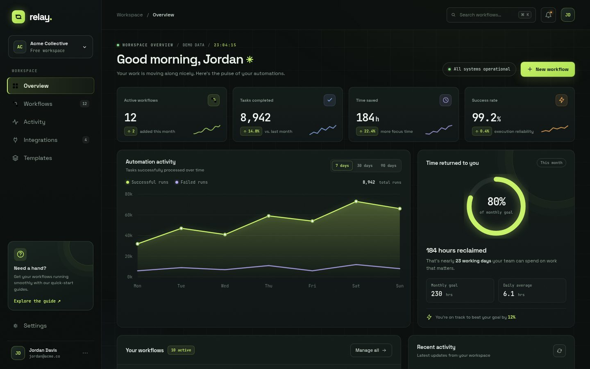

# Relay — Automation Operations Dashboard

**Live demo → https://yasenk90.github.io/relay-ops-dashboard/**

A portfolio concept for a fictional workflow-automation product, designed as a *premium dark mission-control console*: near-black canvas, phosphor-lime accents, monospace data typography, hairline panels, and micro-interactions throughout — built entirely with HTML, CSS, and vanilla JavaScript. No UI kits, no icon libraries, no frameworks.



## Run it

**Option A — open directly.** Double-click `index.html`. The demo works fully offline (webfonts fall back to system stacks).

**Option B — use Vite.**

```bash
npm install
npm run dev
```

## What's interactive

- **⌘K / Ctrl+K** focuses global search, which live-filters both the workflow table and the activity feed
- **Chart ranges** — switch the automation-activity chart between 7, 30, and 90 days (with a line draw-in animation)
- **Workflow toggles** — pause and activate any workflow; stats and badges update live
- **Create a workflow** — the modal adds a real row to the table and an entry to the activity feed
- **Mobile navigation** — full drawer layout down to 390 px
- **Polish details** — count-up stat animations, a live clock in the header, glowing toggles, panel hover brackets, scroll reveals

## Design notes

| Token | Choice |
| --- | --- |
| Canvas | `#0a0e0d` near-black with radial glows + subtle grid + film grain |
| Accent | `#c9f36a` phosphor lime (brand), amber for warnings, violet for failed runs |
| Type | Space Grotesk (UI/display) + JetBrains Mono (all data, labels, timestamps) |
| Depth | Layered surfaces + hairline borders + inset highlights — no heavy drop shadows |
| Motion | 150–400 ms eased transitions; all animation disabled under `prefers-reduced-motion` |

Accessibility: visible lime focus rings, ARIA roles/labels on every control, screen-reader live regions for toasts, and contrast-checked muted text.

## Verification

The demo was verified in real Chromium: 19 automated interaction checks (search, toggles, modal flow, chart ranges, keyboard shortcut, mobile drawer), zero console errors, `npm run build` passing, and a `file://` load test.

## Disclaimer

All data is illustrative. There are no live integrations, external service calls, authentication, or real workflow executions.
